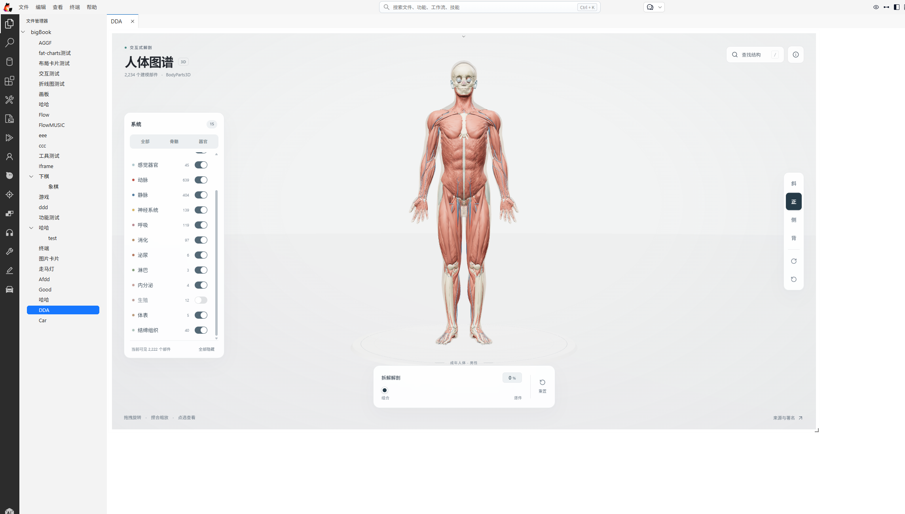
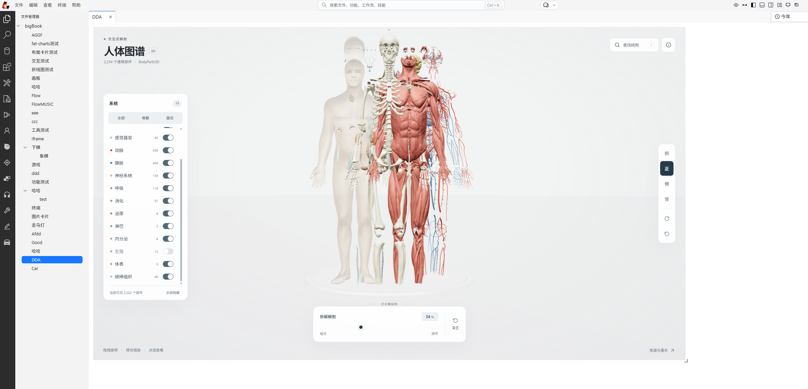

# Human Atlas

An interactive 3D anatomy explorer built with React, Three.js, and shadcn/ui. Take the BodyParts3D adult male reference apart into **2,234 individually selectable meshes**, explore **15 anatomical systems**, and search **3,432 named concepts**.

**[Explore the live demo](https://human-atlas-seven.vercel.app)**

## Explore

- Orbit, zoom, and select structures directly on the body.
- Toggle individual systems or use skeleton and organ presets.
- Move from assembled anatomy to a spaced inventory of every visible piece.
- Search anatomical names and source identifiers.
- Isolate a selected structure and read its details.
- Use compact controls and detail panels on mobile.

## License

Original application code is released under the [MIT License](LICENSE). **The anatomy data has its own CC BY 4.0 license**; preserve the attribution when redistributing it. Third-party dependencies retain their respective licenses.

Issues and pull requests are welcome. Please include reproduction steps and browser/device details for interaction problems.
